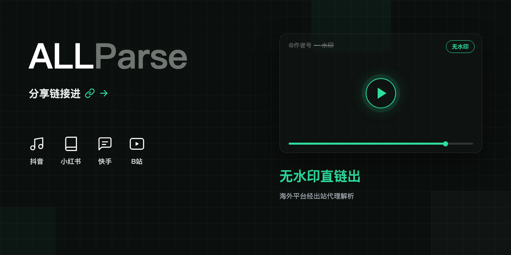

<div align="center">



# ALLParse

**[简体中文](README.md) | [English](README.en.md)**

*Short-video parsing API: paste a share link, get watermark-free video / photo-album direct links.*

[](https://github.com/hey-yx/allparse/actions/workflows/test.yml)
[](https://coveralls.io/github/hey-yx/allparse)
[](https://bun.sh)
[](https://www.typescriptlang.org)
[](LICENSE)

[Quick Start](#quick-start) • [Architecture](#architecture) • [Platforms](#platforms) • [API](#api) • [Configuration](#configuration) • [Local Development](#local-development) • [Deployment](#deployment) • [Docs](#docs)

</div>

> [!WARNING]
> This project is being refactored: APIs and behavior may change at any time. Check the latest implementation before integrating.

Short-video parsing API: give it a share link, get watermark-free video / photo-album direct links back. Supports 9 platforms: Douyin, Xiaohongshu (RedNote), Kuaishou, Bilibili, Weibo, X/Twitter, YouTube, Instagram Reels and TikTok. The default response is direct links (the client downloads without a Referer header), so the server carries zero bandwidth; the `/media` relay is an optional add-on.

- One unified JSON envelope for all 9 platforms, direct links with no watermark
- Pure HTTP primary channels, zero browser dependency by default; browser fallback kicks in on risk control
- Caching, rate limiting, structured logs and Prometheus metrics out of the box
- One-command Docker deployment, image from 495MB

> [!NOTE]
> This project only resolves links: it takes a share link and returns direct-link addresses, storing or re-hosting nothing. Only parse content you have the right to access (your own works or licensed material); you are responsible for how you use it. Platform names and trademarks belong to their respective owners.

## Quick Start

Prerequisites: [Bun](https://bun.sh) 1.2+. Docker and the Gatus image (`docker pull twinproduction/gatus:stable`) are only needed for the availability dashboard.

```bash
git clone https://github.com/hey-yx/allparse.git
cd allparse
bun install
bun dev          # backend, plus the Gatus dashboard when Docker is available (7777 / 8080)
curl http://127.0.0.1:7777/health   # {"status":"ok",...} once it is up
```

Point it at any share link:

```bash
curl -X POST http://127.0.0.1:7777/parse \
  -H 'Content-Type: application/json' \
  -d '{"url": "<share link>"}'
```

You get the unified envelope (see [API](#api)); `data.assets[].url` is the watermark-free direct link, ready to download (without a Referer). No local setup? Run `docker compose up -d` instead, see [Deployment](#deployment). More scenarios (quality tiers, albums, the YouTube relay, error-code handling, rate limits) live in [`docs/调用案例.md`](docs/调用案例.md), Chinese for now.

## Architecture

Request flow: **match (identify the platform) → cache → dispatch (short-link expansion) → fetch (platform adapters) → parse (pure function) → unified envelope response**.

```
src/
├── bootstrap/    # createApp() (callable directly from tests), listen + graceful shutdown
├── routes/       # /parse, /media, /health /ready /platforms /metrics
├── services/     # orchestration: cache (LRU + singleflight), rate limiting, /media relay
├── platforms/    # plugin-style platform layer: adding a platform = add a directory + one registration line
├── core/         # error codes, unified envelope, URL utilities
├── infra/        # pino logging, metrics, Puppeteer browser gateway
└── types/        # unified data model (MediaAsset / ParseResult / FetchCtx)
```

Three hard rules for the platform layer: `platforms/**` never imports Elysia, never reads env, never calls console.log; `parse()` is a pure function (same input, same output) covered by fixture-based offline regression tests; IO goes only through `fetch()` and the injected `FetchCtx`. When a platform changes its pages/APIs, the symptom is "the unit test goes red first", not silently empty results in production.

Tech stack: Bun + Elysia. The only runtime dependencies are elysia, @elysiajs/cors, lru-cache, pino, and puppeteer (needed only on the browser-fallback paths: the Douyin risk-control downgrade and the Xiaohongshu fallback; the pure HTTP primary channels have zero browser dependency). A full directory tour, the add-a-platform steps and test conventions live in [`docs/开发者指南.md`](docs/开发者指南.md) (Chinese).

## Platforms

| Platform | Channel | Content | Quality tiers | Direct link IP-bound |
|---|---|---|---|---|
| Douyin | Three-tier downgrade: signature-free detail API → pure HTTP signed channel → browser fallback | Video, photo albums, live photos | Four tiers 540p/720p/1080p/original (plus a 720p watermarked tier) | No (downloads with an empty Referer) |
| Xiaohongshu (RedNote) | Pure HTTP primary; automatic browser fallback on risk control / login walls | Note videos, album images | Video serves the master stream (h264 preferred); images at original size | No |
| Kuaishou | Pure HTTP (short-link 302 for the photoId + share-page initial data, zero cookies) | Video, albums | All resolutions the server returns, top tier as the main URL | No |
| Bilibili | Pure HTTP (view + playurl) | Video (each part becomes an asset), DASH audio/video split | 360P to 4K | No |
| Weibo | Pure HTTP (anonymous JSON API + video direct-page conversion) | Video, albums | 1080P/720P/480P as served | No |
| X/Twitter | Pure HTTP (public syndication endpoint, signature-free) | Single-tweet video, GIF, albums | mp4 tiers by bitrate + HLS fallback | No |
| YouTube / Shorts | Pure API (innertube, automatic client fallback, no PO Token, no cookies) | Video, Shorts | 144p to 2160p (4K), DASH audio/video split plus merged tiers | **Yes** (googlevideo direct links are bound to the resolving egress IP, ~6h expiry; download via the `/media` server relay, whose egress must match the resolver's) |
| Instagram Reels | Anonymous GraphQL (no login/cookies; requires `IG_GRAPHQL_DOC_ID`) | Reels, Post, IGTV, photo albums | mp4 as returned | No |
| TikTok | Pure HTTP (tikwm public API) | Video, albums, music | Watermark-free play/hdplay tiers | No |

How each channel gets through and what the system does automatically after a risk-control hit (downgrades, sticky circuit breaker, containment) are explained in [`docs/详解-原理与使用.md`](docs/详解-原理与使用.md) and [`docs/research/`](docs/research/) (Chinese). The `via` field in every response honestly reports the channel used (`http` / `http-l2` / `browser`). Domestic platforms connect directly and never use a proxy; overseas platforms (YouTube etc.) can use an egress proxy, see [Configuration](#configuration).

## API

All JSON responses use one unified envelope:

```json
{ "success": true, "data": { ... } }
{ "success": false, "data": null, "error": { "code": "RISK_CONTROL", "message": "..." } }
```

### POST /parse (or GET /parse?url=)

The main endpoint. `Content-Type: application/json`, body `{"url": "<share link>"}`. Share short links are supported (v.douyin.com, xhslink.com, v.kuaishou.com, b23.tv, t.cn, youtu.be, etc., expanded automatically). Repeated parses of the same link hit the cache (at most 30 minutes, or 10 minutes when no resource expiry is known); the top-level `cached` field reports a hit.

`data` (ParseResult) core fields:

| Field | Description |
|---|---|
| `platform` / `id` / `kind` | Platform, platform-native id, `video` \| `album` |
| `title` / `description` / `tags` / `author` | Metadata |
| `assets[]` | Resource list, see below |
| `expiresAt` | Earliest expiry among all direct links (Unix seconds), the basis for caching and re-fetching |
| `via` | Parsing channel: `http` / `http-l2` (the Douyin signed channel) / `browser` |

`assets[]` (MediaAsset): `type` (video/image/audio/cover), `url` (**direct link**: request it without a Referer header; YouTube is the exception, see the table above), `variants[]` (other qualities of the same asset; Douyin returns all four tiers), `width` / `height` / `durationMs` / `size`, `backups[]` (backup CDNs), `liveClipUrl` (the 5s video of a live photo). Bilibili and YouTube video assets additionally carry `audioUrl` (the DASH audio track, fetch it separately and mux it with the video).

Error codes and HTTP status: `INVALID_URL`(400), `UNSUPPORTED_PLATFORM` / `UNSUPPORTED_CONTENT`(422), `CONTENT_NOT_FOUND`(404), `CONTENT_RESTRICTED`(403), `AUTH_REQUIRED`(424), `RISK_CONTROL`(503), `UPSTREAM_ERROR` / `UPSTREAM_CHANGED`(502), `UPSTREAM_TIMEOUT`(504), `RATE_LIMITED`(429), `MEDIA_*` / `CONFIG_MISSING`(501), `INTERNAL`(500). What to do for each code lives in [`docs/调用案例.md`](docs/调用案例.md) §7 (Chinese); rate limiting is a per-IP token bucket at 30 requests/minute (behind a reverse proxy, `X-Real-IP` is used), exceeding it returns 429.

### GET /media?u=&exp=&sig= (optional, off by default)

A streaming relay. Callers of `/parse` don't need this endpoint: direct links work as-is. It serves two cases: YouTube links are IP-bound and must go through the server relay, and self-hosters who want a forced download filename (the `title` parameter) or to cover containers that force a Referer (WeChat's built-in browser and the like).

> [!NOTE]
> Set `PROXY_SECRET` to enable (without it the endpoint returns 501; the direct-link main path is unaffected).

- `sig` = first 32 hex chars of HMAC-SHA256(`PROXY_SECRET`, `"<url>\n<exp>"`), valid for 600 seconds; expired → 410, tampered → 403, with no transparent re-fetch: just `/parse` again for a fresh link. The signing algorithm for rolling your own is in [`docs/调用案例.md`](docs/调用案例.md) §6 (Chinese).
- Upstream domain allowlist (platform share domains + CDN domains), re-validated on every 302 hop (SSRF protection); concurrency capped at 2; Range / HEAD supported.

### Ops endpoints

`GET /health` liveness probe (200 as long as the process is alive, no external dependencies touched, Docker HEALTHCHECK hits it); `GET /ready` readiness probe (200 only when all platform adapters are registered); `GET /platforms` self-describing registry (names, domains, capability declarations); `GET /metrics` Prometheus text format with `parse_total`, `parse_duration_ms`, `cache_hit_total`, `upstream_error_total`, `channel_downgrade_total`, `parse_retry_total`, `channel_breaker_open`, `uifid_mint_total`, `uifid_retired_total`. Logs are pino structured output, one JSON line per request, with `x-request-id` (echoed in the response header); all log output is deeply redacted: URL query values are masked wholesale (parameter names kept, values become `REDACTED`), Error instances and detail fields are redacted recursively, level controlled by `LOG_LEVEL`. How to read these metrics as channel-health signals lives in [`docs/开发者指南.md`](docs/开发者指南.md) §7 (Chinese).

## Configuration

All configuration goes through environment variables; `.env.example` is an annotated template:

| Variable | Default | Description |
|---|---|---|
| `PORT` | 7777 | Listen port |
| `LOG_LEVEL` | info | fatal/error/warn/info/debug/trace |
| `BROWSER_FALLBACK` | on | Master switch for the browser fallback; `off` = pure HTTP everywhere, risk control reported as an honest 503 (saves 400-600 MB resident memory) |
| `DOUYIN_UIFID` | unset | The visitor identity for Douyin's L2 signed channel. Unset → the identity pool mints and reuses one automatically (zero config); set → that identity is pinned, re-minting is covered by `docs/research/01` §12 (Chinese) |
| `DOUYIN_TTWID` | unset | The `ttwid` for Douyin L2 (optional; most reliable when minted together with `DOUYIN_UIFID`); defaults to registering one automatically |
| `IG_GRAPHQL_DOC_ID` | unset | The `doc_id` for Instagram's anonymous GraphQL channel; unset → IG links return `CONFIG_MISSING`(501). Instagram rotates this value on releases |
| `PROXY_SECRET` | unset | Signing secret for the /media relay; unset → /media returns 501 |
| `PUPPETEER_EXECUTABLE_PATH` | - | Pinned to `/usr/bin/chromium` inside the container (set in the Dockerfile) |
| `PROXY_<PLATFORM>` / `HTTPS_PROXY` | unset | Per-platform egress proxy (e.g. `PROXY_YOUTUBE`), the former takes priority, the latter is the fallback; domestic platforms are unaffected. In a container deployment, use an address reachable from the container (`127.0.0.1` inside a container means the container itself) |

The production `.env` stays on the server (chmod 600), never in the repo.

## Local Development

```bash
bun install
bun x --no-install puppeteer browsers install chrome  # install test Chrome before the first run
bun dev          # backend + Gatus dashboard, Ctrl-C stops both; no Docker means no dashboard
bun test         # offline regression tests, including real Chromium tests
bun run test:status  # one command for the full state: prettier / tsc / tests / coverage / CI
bun run typecheck
```

`bun dev` starts the backend, then tries to bring up the monitoring container: if Docker is down, the image is missing or the port is taken, it prints one "skipping availability monitoring" line and keeps developing; force-killing the launcher can leave the monitor container behind (`docker ps -a --filter name=allparse-gatus-dev` to find and stop it). The repo contains the parser API and the Gatus dashboard, not a product frontend; `bun start` runs the backend only. The browser-fallback paths (Douyin risk-control downgrade, Xiaohongshu fallback) need Chrome on the machine (Puppeteer manages it automatically); the pure HTTP channels have no such requirement. CI runs typecheck plus the full test suite on every push / PR, and uploads coverage to Coveralls (badge at the top).

## Deployment

Multi-stage image build: `oven/bun:alpine` compiles a single binary → `alpine:3.22` + chromium runtime (the browser fallback needs it). Runs as non-root (uid 10001), tini reaps zombies, HEALTHCHECK hits /health. Measured size: **495MB** on arm64, **527MB** on amd64 (slimmed from an initial 830MB); the slimming breakdown and build acceptance live in [`docs/image-build-notes.md`](docs/image-build-notes.md) (Chinese). The apk source defaults to the Aliyun mirror (the official one measured at just 14KB/s); to use the official one: `docker build --build-arg ALPINE_MIRROR=dl-cdn.alpinelinux.org .`

```bash
docker build -t allparse:v2 .
docker run -d --name allparse -p 7777:7777 \
  --env-file .env --memory 800m --restart unless-stopped allparse:v2
curl http://127.0.0.1:7777/health
```

Or just compose, which starts two services: `app` (the parser) and `gatus` (a Gatus availability dashboard probing /health, /ready and real parse samples per platform; the check config in `gatus/config.yaml` carries per-item comments, and real samples live in the untracked `gatus/samples.local.yaml`, excluded from both Git and the Docker build context). Host ports default to 7777 (app) and 8080 (gatus); change them if taken.

```bash
docker compose up -d
APP_PORT=7778 GATUS_PORT=8081 docker compose up -d   # different ports
```

Upgrading: rebuild the image, then `docker compose up -d`. Verify `/health`, `/ready` and one real link per platform; rollback is just running the previous image tag.

## Docs

- [`docs/调用案例.md`](docs/调用案例.md): scenario-shaped usage examples: first call, albums, quality tiers, DASH muxing, the YouTube relay signature, error-code handling, rate limits (Chinese)
- [`docs/详解-原理与使用.md`](docs/详解-原理与使用.md): a long-form explainer for users: what makes each platform hard and how it gets through, the Douyin three-tier downgrade, automatic risk-control handling, config choices, troubleshooting (Chinese)
- [`docs/开发者指南.md`](docs/开发者指南.md): local development, directory tour, code conventions, add-a-platform steps, test conventions and the maintenance manual (start here before changing code) (Chinese)
- [`docs/research/`](docs/research/): platform API research and measured notes (01 Douyin/TikTok API, 02 domestic platforms, 03 architecture, 04 Xiaohongshu HTTP channel, 05 overseas platforms and the egress proxy) (Chinese)
- [`docs/image-build-notes.md`](docs/image-build-notes.md): image slimming breakdown and build acceptance checklist (Chinese)
