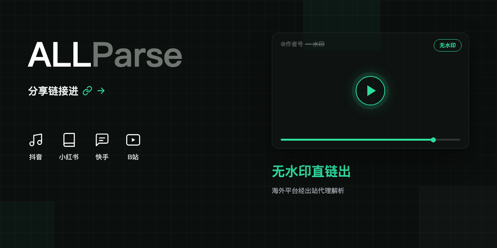

<div align="center">



# ALLParse

**[简体中文](README.md) | [English](README.en.md)**

*短视频解析 API：给一条分享链接，返回无水印视频 / 图集直链。*

[](https://github.com/hey-yx/allparse/actions/workflows/test.yml)
[](https://coveralls.io/github/hey-yx/allparse)
[](https://bun.sh)
[](https://www.typescriptlang.org)
[](LICENSE)

[快速开始](#快速开始) • [架构](#架构) • [平台](#平台) • [API](#api) • [配置](#配置) • [本地开发](#本地开发) • [部署](#部署) • [文档](#文档)

</div>

> [!WARNING]
> 该项目正在重构整改，接口与行为可能随时调整，接入前请先确认最新实现。

短视频解析 API：给一条分享链接，返回无水印视频 / 图集直链。支持 9 个平台：抖音、小红书、快手、B 站、微博、X/Twitter、YouTube、Instagram Reels、TikTok。默认返回直链（客户端请求时不带 Referer 即可下载），服务器零带宽；`/media` 中转作为可选增强。

- 9 个平台统一 JSON 信封，直链无水印
- 纯 HTTP 主通道，默认零浏览器依赖；风控自动降级浏览器兜底
- 缓存、限流、结构化日志、Prometheus 指标开箱即用
- 一条命令 Docker 部署，镜像 495MB 起

> [!NOTE]
> 本项目只做链接解析：收一条分享链接，返回直链地址，不存储、不转存任何内容。请仅解析自己有权访问的内容（自己的作品或已获授权的素材），使用行为由使用者自行负责。文中平台名称与商标归其各自所有者。

## 快速开始

前置：装好 [Bun](https://bun.sh)（1.2+）。想看可用性面板再准备 Docker 和 Gatus 镜像（`docker pull twinproduction/gatus:stable`），没有也能开发。

```bash
git clone https://github.com/hey-yx/allparse.git
cd allparse
bun install
bun dev          # 启动后端；Docker 可用时顺带起 Gatus 面板（7777 / 8080）
curl http://127.0.0.1:7777/health   # 服务起来了会返回 {"status":"ok",...}
```

拿一条分享链接就能解析：

```bash
curl -X POST http://127.0.0.1:7777/parse \
  -H 'Content-Type: application/json' \
  -d '{"url": "<分享链接>"}'
```

返回统一信封（见 [API](#api)），`data.assets[].url` 就是无水印直链，直接下载即可（不带 Referer）。不想装环境可以直接 `docker compose up -d`，见[部署](#部署)。更多场景（选清晰度、图集、YouTube 中转、错误码处置、限流）见 [`docs/调用案例.md`](docs/调用案例.md)。

## 架构

请求流程：**match（识别平台）→ 缓存 → dispatch（短链展开）→ fetch（平台适配层）→ parse（纯函数）→ 统一信封返回**。

```
src/
├── bootstrap/    # createApp()（测试可直接调）、监听与优雅关闭
├── routes/       # /parse、/media、/health /ready /platforms /metrics
├── services/     # 编排：缓存（LRU + singleflight）、限流、/media 中转
├── platforms/    # 插件式平台层：加平台 = 加目录 + 注册一行
├── core/         # 错误码、统一信封、签名器注册表、带代理的 fetch 封装
├── infra/        # pino 日志、指标、Puppeteer 浏览器网关
└── types/        # 统一数据模型（MediaAsset / ParseResult / FetchCtx）
```

平台层三条硬约束：`platforms/**` 不 import Elysia、不读 env、不 console.log；`parse()` 是纯函数（同输入同输出），用 fixture 离线回归；IO 只经 `fetch()` 和注入的 `FetchCtx`。平台改版时的表现是「单测先红」，不是线上悄悄返回空结果。

技术栈：Bun + Elysia。运行时依赖只有 elysia、@elysiajs/cors、lru-cache、pino、puppeteer（仅浏览器兜底路径需要：抖音风控降级、小红书降级兜底；纯 HTTP 主通道零浏览器依赖）。目录导览、加平台步骤与测试写法见 [`docs/开发者指南.md`](docs/开发者指南.md)。

## 平台

| 平台 | 通道 | 支持内容 | 清晰度 | 直链绑 IP |
|---|---|---|---|---|
| 抖音 | 三级降级：零签名 detail 接口 → 纯 HTTP 签名通道 → 浏览器兜底 | 视频、图集、实况照片 | 540p/720p/1080p/原片四档（另附 720p 水印档） | 否（空 Referer 可下） |
| 小红书 | 纯 HTTP 主通道，风控 / 登录墙自动降级浏览器 | 笔记视频、图集图片 | 视频 master 流（h264 优先）；图片原图 | 否 |
| 快手 | 纯 HTTP（短链 302 取 photoId + 分享页初始数据，零 cookie） | 视频、图集 | 服务端返回的全部档位，最高档为主 URL | 否 |
| B 站 | 纯 HTTP（view + playurl） | 视频（多 P 逐个出 asset）、DASH 音视频分离 | 360P 到 4K | 否 |
| 微博 | 纯 HTTP（匿名 JSON 接口 + 视频直链页换算） | 视频、图集 | 1080P/720P/480P 等服务端档位 | 否 |
| X/Twitter | 纯 HTTP（公开 syndication 接口，免签名） | 单条推文视频、GIF、图集 | mp4 按 bitrate 多档 + HLS 备选 | 否 |
| YouTube / Shorts | 纯 API（innertube，自动换 client，免 PO Token 免 cookie） | 视频、Shorts | 144p 到 2160p（4K），DASH 音视频分离 + 合并档 | **是**（googlevideo 直链绑解析出口 IP，约 6h 过期，必须经 `/media` 服务端中转，中转与解析走同一代理出口） |
| Instagram Reels | 匿名 GraphQL（免登录免 cookie，需配 `IG_GRAPHQL_DOC_ID`） | Reels、Post、IGTV、图文图集 | mp4 按源返回 | 否 |
| TikTok | 纯 HTTP（tikwm 公开接口） | 视频、图集、音乐 | 无水印 play/hdplay 双档 | 否 |

被风控后系统怎么自动降级、熔断与止血，各通道怎么过，原理与实测见 [`docs/详解-原理与使用.md`](docs/详解-原理与使用.md) 与 [`docs/research/`](docs/research/)。解析结果 `via` 字段如实标注实际通道（`http` / `http-l2` / `browser`）。国内平台直连不走代理；海外平台（YouTube 等）可配出站代理，见[配置](#配置)。

## API

所有 JSON 响应走统一信封：

```json
{ "success": true, "data": { ... } }
{ "success": false, "data": null, "error": { "code": "RISK_CONTROL", "message": "..." } }
```

### POST /parse（或 GET /parse?url=）

主接口。`Content-Type: application/json`，body `{"url": "<分享链接>"}`。支持分享短链（v.douyin.com、xhslink.com、v.kuaishou.com、b23.tv、t.cn、youtu.be 等，自动展开）。同一链接重复解析命中缓存（最长 30 分钟，未取得过期时间时默认 10 分钟），响应顶层 `cached` 标记是否命中。

`data`（ParseResult）核心字段：

| 字段 | 说明 |
|---|---|
| `platform` / `id` / `kind` | 平台、平台内 ID、`video` \| `album` |
| `title` / `description` / `tags` / `author` | 元数据 |
| `assets[]` | 资源列表，见下 |
| `expiresAt` | 所有直链里最早过期的时刻（Unix 秒），缓存与重取依据 |
| `via` | 解析通道：`http` / `http-l2`（抖音签名通道）/ `browser` |

`assets[]`（MediaAsset）：`type`（video/image/audio/cover）、`url`（**直连地址**，客户端请求时不要带 Referer；YouTube 除外，见上表）、`variants[]`（同资源的其他档位，抖音给全四档）、`width` / `height` / `durationMs` / `size`、`backups[]`（备用 CDN）、`liveClipUrl`（实况照片的 5s 视频）。B 站与 YouTube 视频另带 `audioUrl`（DASH 音轨，需与视频分别拉取后合成）。

错误码与 HTTP 状态：`INVALID_URL`(400)、`UNSUPPORTED_PLATFORM` / `UNSUPPORTED_CONTENT`(422)、`CONTENT_NOT_FOUND`(404)、`CONTENT_RESTRICTED`(403)、`AUTH_REQUIRED`(424)、`RISK_CONTROL`(503)、`UPSTREAM_ERROR` / `UPSTREAM_CHANGED`(502)、`UPSTREAM_TIMEOUT`(504)、`RATE_LIMITED`(429)、`MEDIA_PROXY_DISABLED` / `CONFIG_MISSING`(501)、`MEDIA_BAD_SIGNATURE`(403)、`MEDIA_LINK_EXPIRED`(410)、`INTERNAL`(500)。每个码该怎么办见 [`docs/调用案例.md`](docs/调用案例.md) §7；限流为按 IP 令牌桶 30 次/分钟（反代后用 `X-Real-IP`），超限 429。

### GET /media?u=&exp=&sig=（可选，默认关闭）

流式中转。调用 `/parse` 的客户端用不到它：正常情况直链拿来就能用。它服务两类场景：YouTube 直链绑 IP 必须经服务端中转；自部署的维护者想要强制下载文件名（`title` 参数）、替会强制带 Referer 的容器（微信内置浏览器等）代取。

> [!NOTE]
> 配置 `PROXY_SECRET` 后启用（未配置返回 501，直链主路径不受影响）。

- `sig` = HMAC-SHA256(`PROXY_SECRET`, `"<url>\n<exp>"`) 前 32 位十六进制，有效期 600 秒；过期 410、篡改 403，不做透明重取，重新 `/parse` 取新链接即可。自己拼签名的算法见 [`docs/调用案例.md`](docs/调用案例.md) §6。
- 上游域名白名单（平台分享域 + CDN 域），302 每跳重新校验（SSRF 防护）；并发上限 2；支持 Range / HEAD。

### 运维端点

`GET /health` 存活探针（进程活着即 200，不查外部依赖，Docker HEALTHCHECK 打这里）；`GET /ready` 就绪探针（平台适配器注册齐才 200）；`GET /platforms` 已注册平台自描述（名称、域名、能力声明）；`GET /metrics` Prometheus 文本格式，指标有 `parse_total`、`parse_duration_ms`、`cache_hit_total`、`upstream_error_total`、`channel_downgrade_total`、`parse_retry_total`、`channel_breaker_open`、`uifid_mint_total`、`uifid_retired_total`。日志为 pino 结构化输出，一行一请求，带 `x-request-id`（响应头回写）；所有日志输出深度脱敏：URL 的 query 值整体打码（参数名保留，值一律 `REDACTED`），Error 与 detail 递归脱敏，级别由 `LOG_LEVEL` 控制。各指标怎么看信号、出了问题怎么处置见 [`docs/开发者指南.md`](docs/开发者指南.md) §7。

## 配置

全部配置走环境变量，`.env.example` 有一份带注释的模板：

| 变量 | 默认 | 说明 |
|---|---|---|
| `PORT` | 7777 | 监听端口 |
| `LOG_LEVEL` | info | fatal/error/warn/info/debug/trace |
| `BROWSER_FALLBACK` | on | 浏览器兜底总开关；设 `off` 全平台纯 HTTP，风控如实 503（省 400-600 MB 常驻内存） |
| `DOUYIN_UIFID` | 未配置 | 抖音 L2 签名通道的访客身份。不配时身份池自动铸造并复用（零配置启用 L2）；显式配置则固定该身份，失效重铸见 `docs/research/01` §12 |
| `DOUYIN_TTWID` | 未配置 | 抖音 L2 的 `ttwid`（可选，与 `DOUYIN_UIFID` 同一次铸造带出最稳）；缺省自动注册一个 |
| `IG_GRAPHQL_DOC_ID` | 未配置 | Instagram 匿名 GraphQL 的 `doc_id`；不配时 IG 返回 `CONFIG_MISSING`(501)，平台发版会轮换此值 |
| `PROXY_SECRET` | 未配置 | /media 中转签名密钥；不配则 /media 返回 501 |
| `PUPPETEER_EXECUTABLE_PATH` | - | 容器内固定 `/usr/bin/chromium`（Dockerfile 已设） |
| `PROXY_<PLATFORM>` / `HTTPS_PROXY` | 未配置 | 海外平台出站代理（如 `PROXY_YOUTUBE`），前者优先，后者兜底；国内平台不受影响。容器部署时写宿主代理对容器可达的地址（`127.0.0.1` 在容器内指容器自己） |

生产 `.env` 放服务器本地（chmod 600），不进仓库。

## 本地开发

```bash
bun install
bun x --no-install puppeteer browsers install chrome  # 首次测试前安装测试用 Chrome
bun dev          # 后端 + Gatus 面板，Ctrl-C 一起停；Docker 不可用只跳过面板
bun test         # 离线回归，含真实 Chromium 浏览器测试
bun run test:status  # 一条命令看全状态：格式 / 类型 / 单测 / 覆盖率 / CI
bun run typecheck
```

`bun dev` 先起后端，再尝试拉监控容器：Docker 没开、镜像没拉或端口被占时，只打印一句「跳过可用性监控」并照常开发；强制杀掉启动器可能残留监控容器（`docker ps -a --filter name=allparse-gatus-dev` 查收）。仓库只有解析 API 与 Gatus 面板，没有业务前端，`bun start` 只起后端。浏览器兜底路径（抖音风控降级、小红书降级兜底）需要本机有 Chrome（Puppeteer 自动管理），纯 HTTP 通道无此要求。CI 在每次 push / PR 上跑 typecheck 与全部测试，覆盖率上传 Coveralls（见顶部徽章）。

## 部署

镜像多阶段构建：`oven/bun:alpine` 编译单二进制 → `alpine:3.22` + chromium 运行时（浏览器兜底需要）。非 root（uid 10001）运行，tini 收僵尸进程，HEALTHCHECK 打 /health。实测体积 arm64 **495MB**、amd64 **527MB**（从初始 830MB 裁到）；裁剪明细与构建验收见 [`docs/image-build-notes.md`](docs/image-build-notes.md)。apk 源默认阿里云镜像（官方源实测仅 14KB/s），换官方源：`docker build --build-arg ALPINE_MIRROR=dl-cdn.alpinelinux.org .`

```bash
docker build -t allparse:v2 .
docker run -d --name allparse -p 7777:7777 \
  --env-file .env --memory 800m --restart unless-stopped allparse:v2
curl http://127.0.0.1:7777/health
```

或直接 compose，一次起两个服务：`app`（解析服务）和 `gatus`（Gatus 可用性面板，探 /health、/ready 与各平台真实解析样例；检查配置在 `gatus/config.yaml` 自带逐条注释，真实样例放在不入库的 `gatus/samples.local.yaml`，已被 Git 与 Docker 构建上下文排除）。宿主端口默认 7777（app）与 8080（gatus），被占就换。

```bash
docker compose up -d
APP_PORT=7778 GATUS_PORT=8081 docker compose up -d   # 换端口示例
```

升级：重新构建镜像后 `docker compose up -d`，确认 `/health`、`/ready` 与每平台一条真实链接解析通过即完成；回滚就是换回旧镜像 tag。

## 文档

- [`docs/调用案例.md`](docs/调用案例.md)：面向调用方的场景示例（最简调用、图集、选清晰度、DASH 合成、YouTube 中转签名、错误码处置、限流）
- [`docs/详解-原理与使用.md`](docs/详解-原理与使用.md)：写给使用者的原理长文（各平台的关卡与过法、抖音三层降级、风控后的自动处置、配置怎么选、排错）
- [`docs/开发者指南.md`](docs/开发者指南.md)：本地开发、目录导览、代码约定、加平台步骤、测试写法与维护手册（改代码前从这里开始）
- [`docs/research/`](docs/research/)：平台 API 调研与实测记录（01 抖音/TikTok API、02 国内平台、03 架构、04 小红书 HTTP 通道、05 海外平台与出站代理）
- [`docs/image-build-notes.md`](docs/image-build-notes.md)：镜像裁剪明细与构建验收清单
